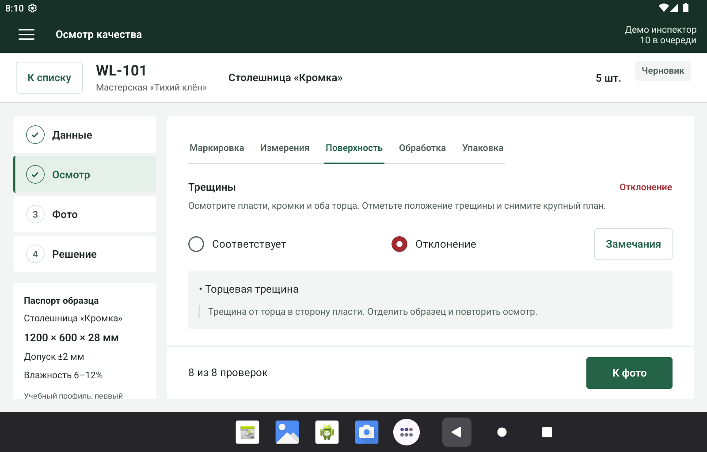
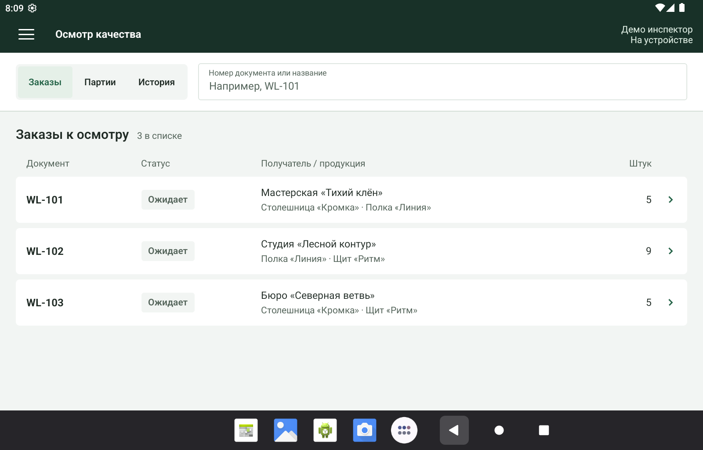
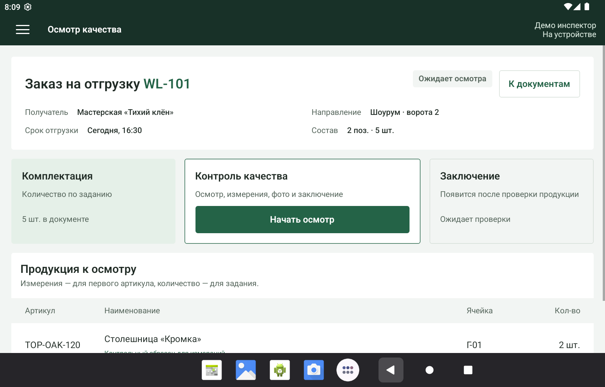
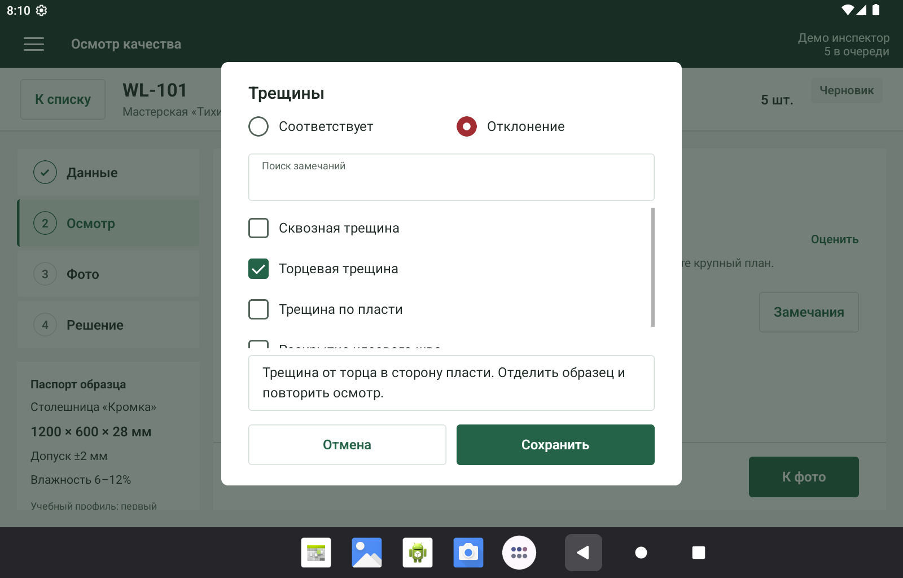
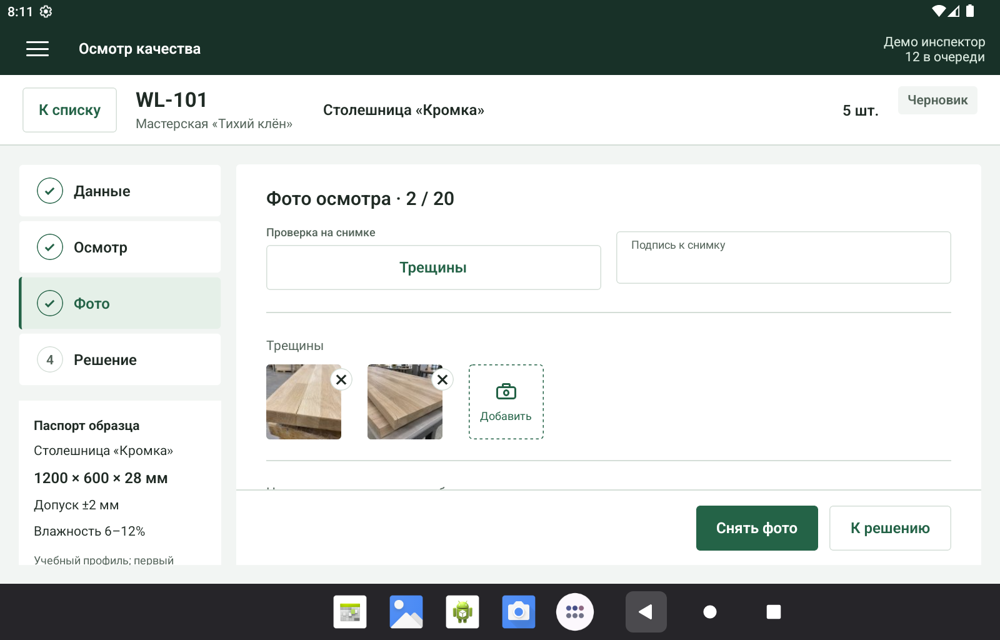
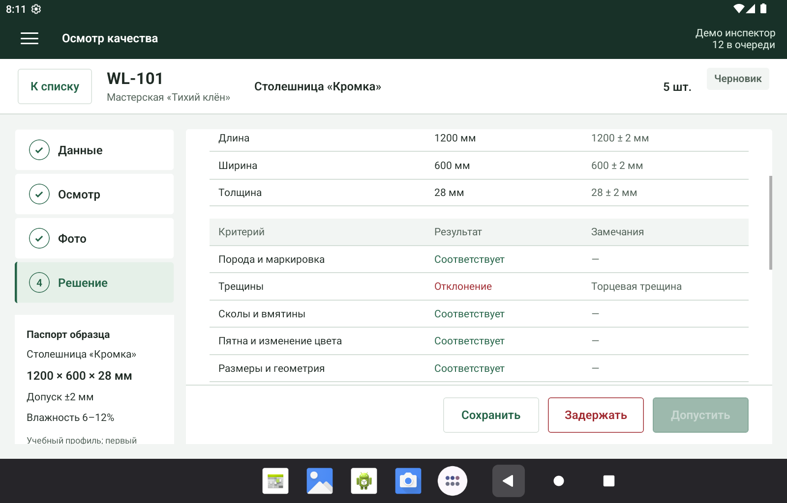
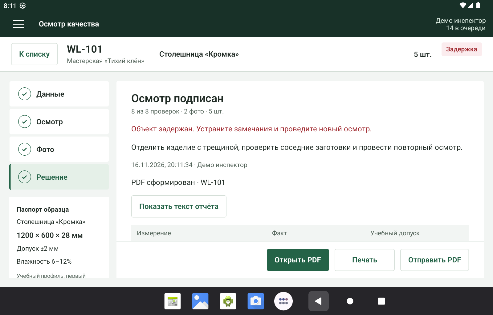

# Woodland Quality

Демонстрационное Android-приложение для контроля качества древесины и готовых деревянных изделий. Рассчитано на небольшой планшет в альбомной ориентации и управление в перчатках.

Инспектор выбирает заказ или материал, проверяет маркировку, поверхность, размеры, влажность, обработку и упаковку. Замечания выбираются из списка, дата — в календаре, фотографии снимаются камерой планшета и привязываются к проверкам. Осмотр завершается допуском или задержкой и PDF-отчётом с таблицами и фотографиями. Отчёт можно открыть, передать или отправить в системное окно печати Android. Отгрузка доступна только с актуальным допуском.

Также реализованы локальный профиль с PIN, складские остатки, подбор и упаковка, история осмотров и очередь обмена с локальным симулятором. Данные вымышлены; учебные допуски не являются отраслевым нормативом. Измерения заказа относятся к указанному контрольному образцу первого артикула. Для сканера есть интерфейс приёма строк; аппаратный драйвер и сервер не подключены.

Приложение написано на React Native и TypeScript. Экраны и компоненты сгруппированы по функциям в `src/features`, общие элементы интерфейса находятся в `src/shared/ui`. React Navigation управляет разделами, Redux Toolkit предоставляет экранам сохранённое состояние, а Reanimated подсвечивает смену этапа осмотра. Снимок склада хранится в AsyncStorage. Камера, календарь и PDF подключены через нативный модуль Android.

## Экраны планшета

| Выбор документа | Карточка заказа |
| --- | --- |
|  |  |
| **Замечания к критерию** | **Галерея осмотра** |
|  |  |
| **Итоги проверок** | **Подписанное заключение** |
|  |  |

[Экран входа по PIN](review/pin.png) · [Данные и замеры образца](review/inspection.png) · [Просмотр снимка](review/photo-carousel.png)

**Результат осмотра — [пример PDF-отчёта по заказу WL-101](review/woodland-quality-report.pdf).** В отчёте есть паспорт заказа, фактические замеры, отклонение по поверхности, заключение о задержке отгрузки и два фото с подписями. Отчёт сформирован приложением на вымышленных данных. Фотографии образца сгенерированы для демонстрации.

[Запуск и разработка](docs/DEVELOPMENT.md) · [Происхождение компонентов](docs/PROVENANCE.md)
